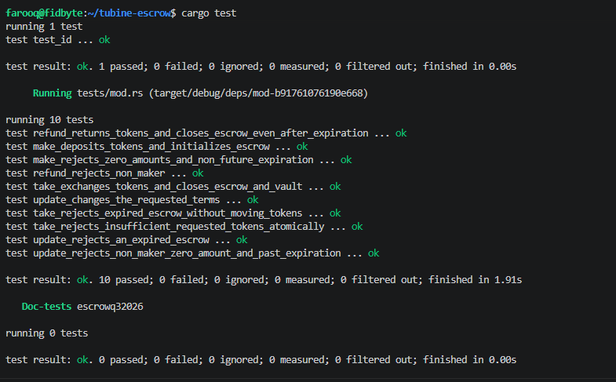

# Solana Token Escrow

A Solana program for trust-minimized, atomically settled swaps between two
token holders. A maker deposits token A into a PDA-controlled vault and names
the amount of token B they want. A taker can complete the swap before the
escrow expires; otherwise, the maker can reclaim the deposit.

The program is built with [Anchor](https://www.anchor-lang.com/) and uses
Anchor's token interface for checked token transfers.

> **Status:** Development project. The program has not been independently
> audited and should not be used to custody production funds.

## How it works

1. The maker creates an escrow with a unique seed, a token A deposit, a token B
   amount to receive, and an expiration timestamp.
2. The program stores the offer in an escrow PDA and transfers token A into an
   associated token account controlled by that PDA.
3. Before expiration, a taker can pay the requested token B amount to the maker.
   The program then releases token A to the taker and closes the escrow and
   vault in the same transaction.
4. The maker can update the requested amount and expiration while the escrow is
   active, or refund the deposit and close the accounts at any time.

The escrow PDA is derived from the `escrow` seed prefix, maker public key, and
the maker-provided `u64` seed. Token amounts use the mint's base units (for
example, a six-decimal token amount of `1` token is `1_000_000`).

## Instructions

| Instruction | Signer | Behavior |
| --- | --- | --- |
| `make(seed, deposit, receive, expiration)` | Maker | Creates the escrow and token A vault, then transfers the deposit. Deposit and requested amounts must be nonzero; expiration must be in the future. |
| `take()` | Taker | Before expiration, transfers the requested token B amount from the taker to the maker, releases all token A in the vault to the taker, and closes the escrow and vault. |
| `refund()` | Maker | Returns the token A vault balance to the maker and closes the escrow and vault. Available even after expiration. |
| `update(receive, expiration)` | Maker | Updates the requested token B amount and expiration on an active escrow. The requested amount must be nonzero and the new expiration must be in the future. |

## Repository layout

```text
programs/escrowq32026/
├── src/
│   ├── instructions/  # Anchor account constraints and instruction handlers
│   ├── state.rs       # Escrow account state
│   ├── error.rs       # Program errors
│   └── lib.rs         # Program entrypoints
└── tests/mod.rs       # LiteSVM integration tests
screenshots/           # Test result screenshot
```

## Requirements

- Rust (stable toolchain; the workspace specifies Rust 1.89 or newer)
- Solana CLI and the Solana SBF build tools
- Anchor CLI compatible with the Anchor 1.1.2 dependencies in this workspace

## Build and test

From the repository root, build the on-chain program first (the LiteSVM
integration tests load its compiled `.so`), then run the Rust tests:

```bash
anchor build
cargo test -p escrowq32026
```

The integration suite uses LiteSVM and local SPL token mints/accounts; it does
not require a validator or a connection to a Solana cluster. It covers:

- Successful escrow creation and deposit, and rejection of invalid amounts or
  expiration.
- Maker updates, including authorization, amount, and expiration checks.
- Successful atomic take, expiration rejection, and insufficient-taker-balance
  rollback.
- Maker refund, including refund after expiration and rejection of an
  unauthorized caller.

### Test results

The screenshot below shows the Rust test run with all ten LiteSVM integration
tests passing:

