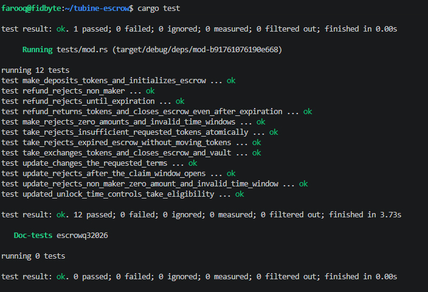

# Solana Token Escrow

A Solana program for trust-minimized, atomically settled swaps between two
token holders. A maker deposits token A into a PDA-controlled vault, names the
amount of token B they want, and sets a claim window using Solana's `Clock`
sysvar. A taker can complete the swap during that window; after it closes, the
maker can reclaim the deposit.

The program is built with [Anchor](https://www.anchor-lang.com/) and uses
Anchor's token interface for checked token transfers.

> **Status:** Development project. The program has not been independently
> audited and should not be used to custody production funds.
>
> **Upgrade note:** The timed claim window adds a timestamp to escrow account
> state. Resolve all escrows created with the previous account layout before
> upgrading a deployed instance; this project does not include an account
> migration instruction.

## How it works

1. The maker creates an escrow with a unique seed, a token A deposit, a token B
   amount to receive, an unlock timestamp, and a later expiration timestamp.
2. The program stores the offer in an escrow PDA and transfers token A into an
   associated token account controlled by that PDA.
3. Before `unlock_at`, the offer cannot be taken and its terms cannot be
   changed. At or after `unlock_at` and before `expiration`, a taker can pay the
   requested token B amount to the maker. The program releases token A to the
   taker and closes the escrow and vault in the same transaction.
4. The maker can update the requested amount and both timestamps before the
   claim window opens. At or after `expiration`, the maker can refund the
   deposit and close the accounts. A refund is not allowed during the claim
   window.

The escrow PDA is derived from the `escrow` seed prefix, maker public key, and
the maker-provided `u64` seed. Timestamps are Unix seconds read from the Solana
`Clock` sysvar. `make` requires `now < unlock_at < expiration`. The taker may
claim when `unlock_at <= now < expiration`; the maker may refund when
`now >= expiration`. Token amounts use the mint's base units (for example, a
six-decimal token amount of `1` token is `1_000_000`).

## Instructions

| Instruction | Signer | Behavior |
| --- | --- | --- |
| `make(seed, deposit, receive, unlock_at, expiration)` | Maker | Creates the escrow and token A vault, then transfers the deposit. Amounts must be nonzero and the timestamps must satisfy `now < unlock_at < expiration`. |
| `take()` | Taker | Only succeeds when `unlock_at <= Clock.unix_timestamp < expiration`. Transfers the requested token B amount from taker to maker, releases all token A in the vault to the taker, and closes the escrow and vault. |
| `refund()` | Maker | Only succeeds when `Clock.unix_timestamp >= expiration`. Returns the token A vault balance to the maker and closes the escrow and vault. |
| `update(receive, unlock_at, expiration)` | Maker | Before `unlock_at`, updates the requested token B amount and claim window. The amount must be nonzero and the new timestamps must satisfy `now < unlock_at < expiration`. |

## Repository layout

```text
programs/escrowq32026/
├── src/
│   ├── instructions/  # Anchor account constraints and instruction handlers
│   ├── state.rs       # Escrow account state
│   ├── error.rs       # Program errors
│   └── lib.rs         # Program entrypoints
└── tests/mod.rs       # LiteSVM integration tests
screenshots/           # Test result screenshot
```

## Requirements

- Rust (stable toolchain; the workspace specifies Rust 1.89 or newer)
- Solana CLI and the Solana SBF build tools
- Anchor CLI compatible with the Anchor 1.1.2 dependencies in this workspace

## Build and test

From the repository root, build the on-chain program first (the LiteSVM
integration tests load its compiled `.so`), then run the Rust tests:

```bash
anchor build
cargo test -p escrowq32026
```

The integration suite uses LiteSVM and local SPL token mints/accounts; it does
not require a validator or a connection to a Solana cluster. It covers:

- Successful escrow creation and deposit, and rejection of invalid amounts or
  claim windows.
- Maker updates before unlock, including authorization, amount, and timestamp
  checks; updates are rejected once the claim window opens.
- Atomic take is rejected before unlock, succeeds during the claim window, and
  is rejected after expiration; insufficient taker balances roll back.
- Maker refunds are rejected before expiration (including during the claim
  window), succeed after expiration, and reject unauthorized callers.

### Test results

The screenshot below records a passing LiteSVM run of the earlier ten-test
suite. The current suite also covers the timed claim window and can be run with
the commands above.

